

  <picture>
    <source media="(prefers-color-scheme: dark)" srcset="docs/branding/TrueScope_Logo_dark.svg">
    <source media="(prefers-color-scheme: light)" srcset="docs/branding/TrueScope_Logo_light.svg">
    
  </picture>

# TrueScope

### Professional video scopes, directly inside Unreal Engine.

Waveform, Parade, Vectorscope and Histogram help artists identify exposure and color issues early while decisions are still being made inside the scene.

This reduces unnecessary workflow roundtrips for a shorter path from scene to final rendering. 
The goal is not to replace dedicated color-grading applications, but to bring their familiar measurement tools into the real-time creation process.

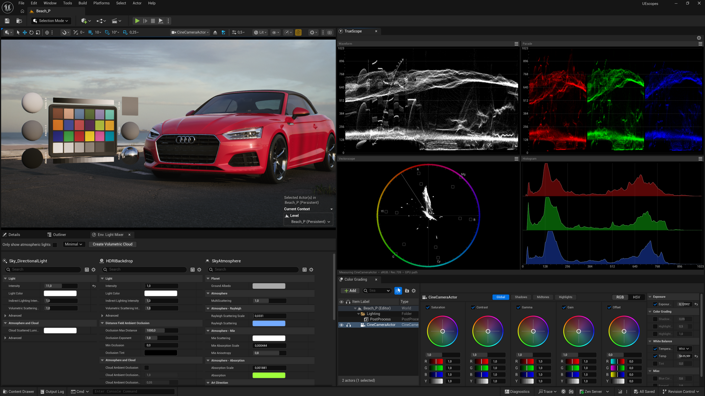

*Beta · Unreal Engine 5.8 · Windows AMD/NVIDIA GPUs · macOS Apple Silicon/Metal · Apache-2.0*

### What you see is what you measure
TrueScope is designed to work hand-in-hand with Unreal's lighting, exposure and color grading tools. It measures the active viewport **after tonemapping, post-processing and OpenColorIO view transforms** — the scopes read the same signal the monitor receives for true WYSIWYG.

## Features

- **Four scopes with display modes** — Waveform (RGB and Luma-Y), RGB Parade, Vectorscope (skin tone line, 75% and 100% target markers, 2x Zoom), Histogram (RGB, YRGB and Photoshop-like Overlay) in a dockable 2×2 editor window.

- **Calibrated against DaVinci Resolve** — scope response, graticules, scales and density transfer were measured repeatedly against DaVinci Resolve using test patterns and reference images with known pixel populations, not just matched by eye.

- **OpenColorIO aware** — the active OCIO view transform is applied before measurement and named in the status line.

- **Familiar 0–1023 scale** — following conventions commonly used in professional color workflows.

- **Zero asset footprint** — no assets, no level actors. The plugin is editor-only and never interferes with your packaged build.

- **Analysis runs on GPU** for performance, with an optional **CPU path** for maximum compatibility with any setup.

- **Status line** naming what is being measured: active viewport/camera, color space, analysis path (GPU/CPU) and the active OpenColorIO transform at a glance without tedious double-checking in editor menus.

- **Adjust Trace Brightness and Histogram Gain** for clearer readings in all situations.

- **Cross-platform** — Windows and **Mac support**! 

## Video Scopes

#### Waveform RGB and Luma(Y)

  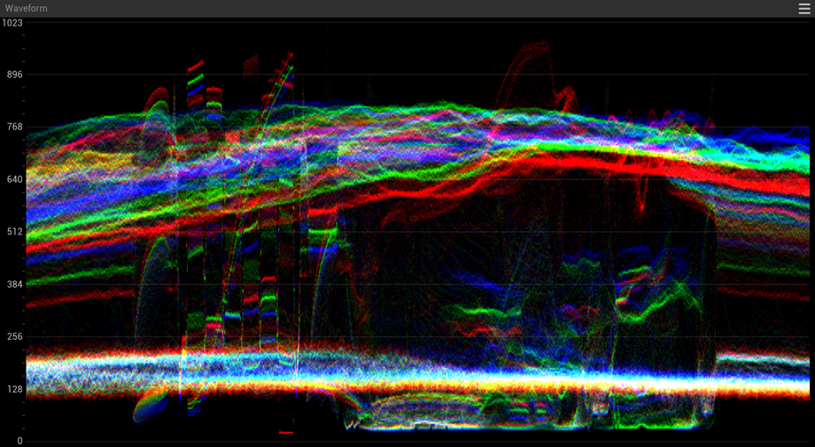&nbsp;
  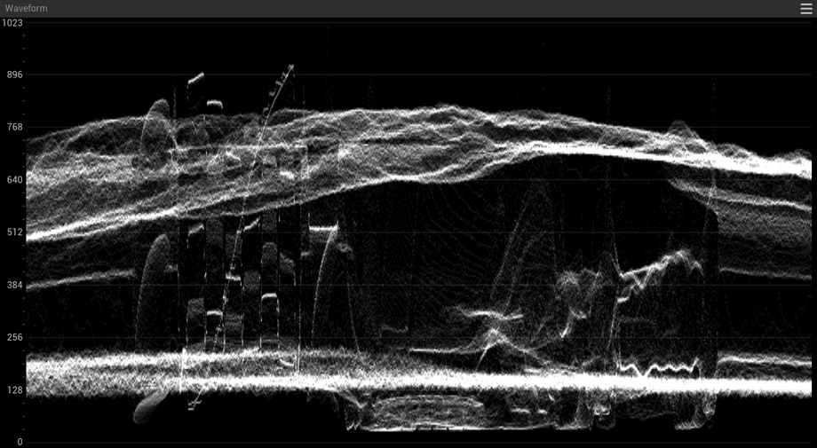

#### RGB Parade, RGB Overlay Histogram

  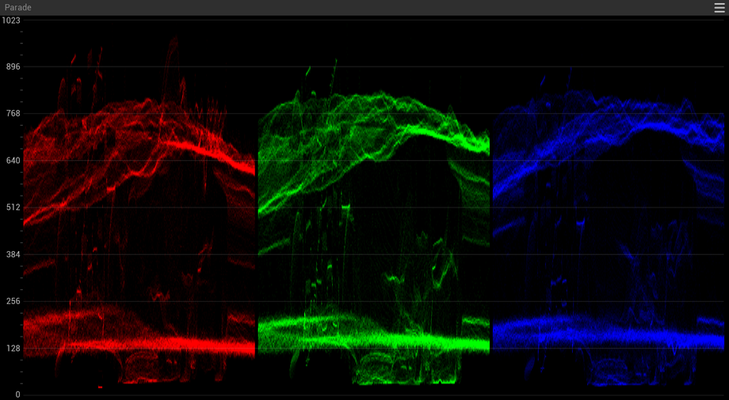&nbsp;
  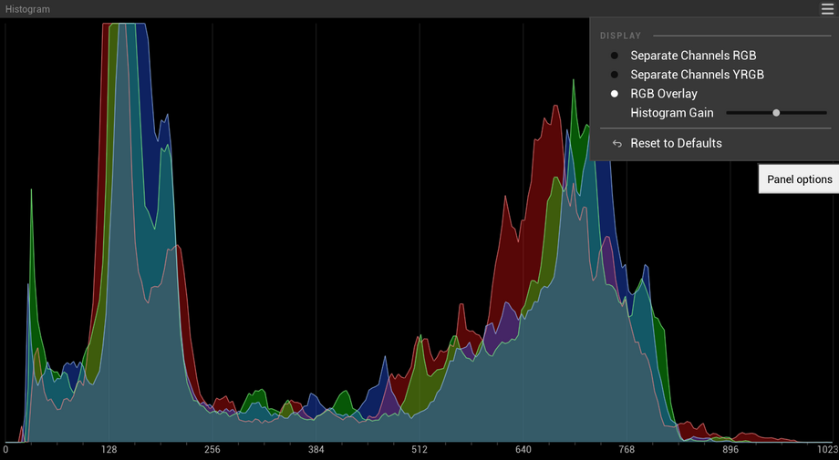

#### Vectorscope with 75% and 100% markers, skin tone line, 2x Zoom

  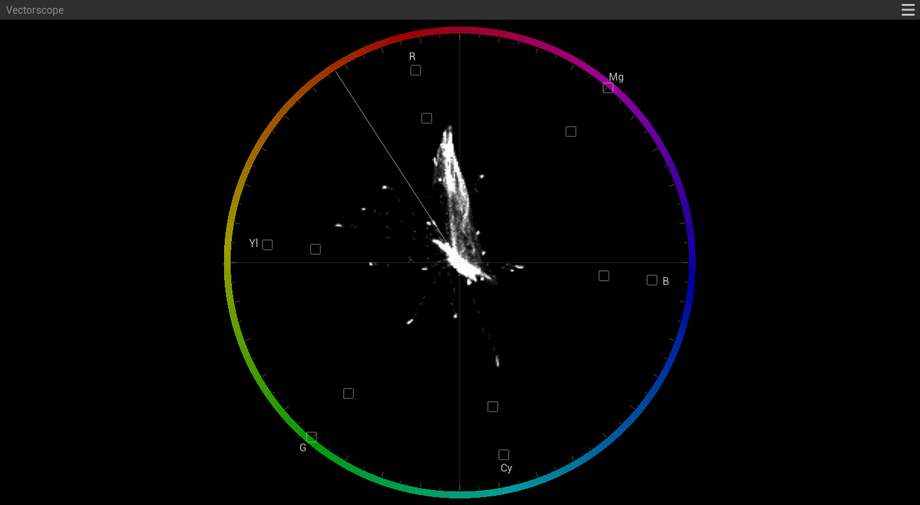&nbsp;
  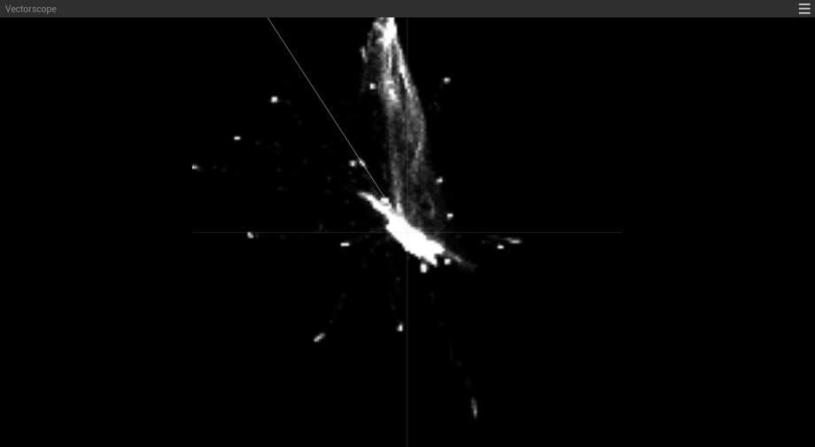

#### Histogram RGB and Luma(Y)-RGB

  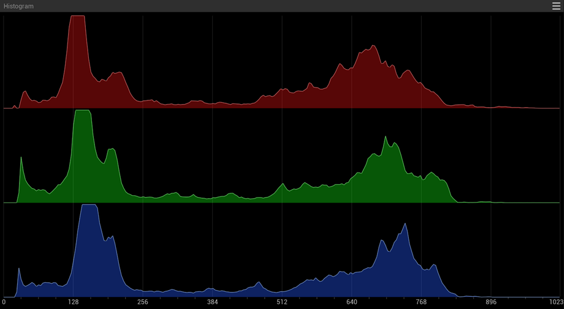&nbsp;
  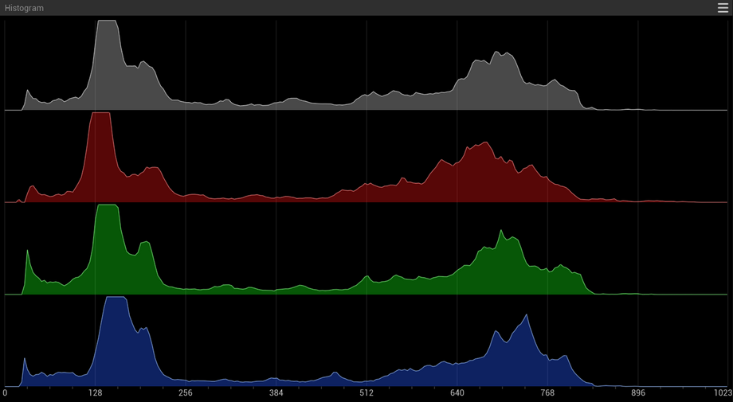

#### Status info bar

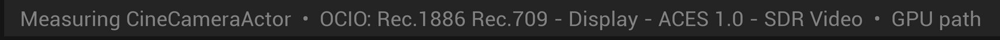

## Measurement principle

- **Measures the active viewport or camera** — a plain Perspective Viewport, a Cinematic
  Viewport or CineCameraActor. All three types are supported.

- **UI, editor gizmos and letterbox bars do not leak into the measurement.** TrueScope only 
  samples your scene. No worries about black bars, widgets or billboard icons affecting measurements.

- **Independent from viewport size or layout.** The scopes use a fixed internal analysis resolution, so readings do not depend on your viewport size or aspect ratio.

- **Tapped as late as possible in the render pipeline.** The capture and measurement happen after the tonemapper and OpenColorIO transforms, so the scope values are always what you see on screen. None of them is required, though: you are free to adjust or even disable the tonemapper, post-processing or OpenColorIO in the Unreal Editor and the scopes will still measure and reflect the changes.

## Requirements

- Unreal Engine **5.8**

- Building from source needs the compiler toolchain for your engine version (Visual Studio or Xcode). Those requirements can change between engine releases — please follow Epic's documentation.

## Install from source

1. Clone or copy this repository to `<YourUnrealProject>/Plugins/TrueScope/`.

2. Start the editor and let it build the plugin, or build the project from your IDE first.

3. Enable **TrueScope** in the Unreal Editor under *Edit → Plugins*. OpenColorIO plugin is a dependency and Unreal will ask to enable it as well. Then restart.

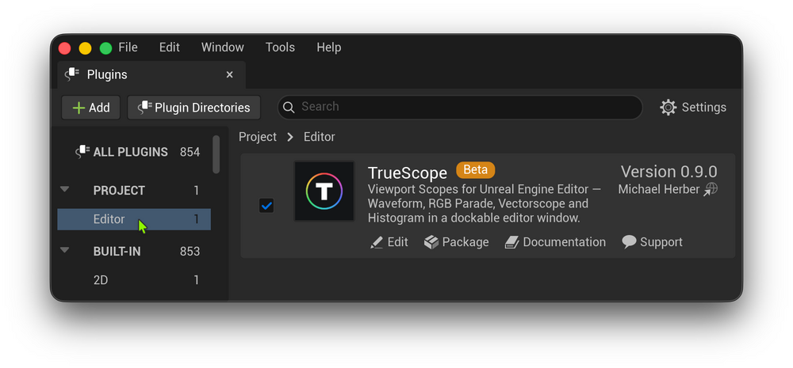

## Quick start

1. In the Unreal Editor, open **Window → TrueScope**.

2. **Click into any editor viewport** to make it the source. The scopes measure the active (last focused) level viewport.

3. Each panel's **hamburger menu** holds that scope's options; the **gear icon** in the main bar holds the global options.

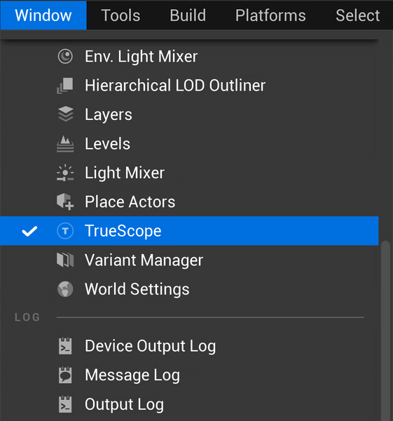&nbsp;&nbsp;&nbsp;
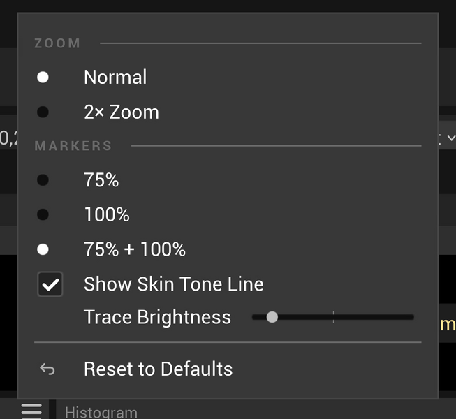

**Q: How do I work with video scopes?**

A: Same way here as in DaVinci Resolve, Final Cut Pro or any other scope tool. You can easily find great free tutorials and articles on scope-based exposure and color work (color correction and color grading) and apply it here.

## Known limitations

- **SDR only, for now.** V1 is calibrated for sRGB / Rec.709 display output. With
  OpenColorIO view transforms targeting P3, PQ or HLG the scopes still measure
  the real display signal, but the percentage scale and the vectorscope targets
  have only been calibrated and verified against sRGB / Rec.709. See the [Roadmap](#project-status--roadmap).

- **During Play In Editor (PIE) the scopes hold the last frame.** Starting a play
  session disables realtime rendering on every Unreal Editor viewport, so no new frames
  arrive. Focusing another viewport during a play session does resume measurement. If you need to measure a scene with runtime content, you may also consider using 'Simulate' instead of PIE.

- **Standalone Game is not measured.** It runs as a separate process with no
  editor module, so TrueScope (being an editor plugin) does not load there.

- **Linux:** builds from source, untested.

## Project status & Roadmap

Actively developed as a side project by one person. Issues and feature requests are read and welcome — however 
there is no response-time commitment, and not everything will be built. Provided
as-is under Apache-2.0; see [LICENSE](LICENSE).

These are the directions the project is likely to take next (no fixed schedule):

- **Better capture rate options** — Low / Normal / Every frame, replacing the current fixed set. What is currently missing is an extensive measurement session.

- **Panel layout options** — Several scope panel layout options (more than DaVinci Resolve offers), with per-panel
  scope type selection so artists have more flexibility. Already planned and UI icons are designed and ready.

- **Viewport overlays** — zebra, over/under-exposure warning, false color to add to TrueScope's capabilities.

- **Wider color-space support** — calibration and verification beyond sRGB / Rec.709. This is especially important for virtual production pipelines. The engine delivers the post-tonemap image as 10-bit A2B10G10R10, but TrueScope currently captures into an 8-bit target; a higher-precision capture is part of this work.

- **Cross-platform parity verification** — confirm that Windows and macOS produce the same values on both analysis paths.

**Current verification status**

| Platform | Engine | GPU | Toolchain | Verification |
|---|---|---|---|---|
| macOS (Apple Silicon) | 5.8.1 | Apple M-series | Xcode 26.1.1 | Full automation suite |
| Windows 11 | 5.8.2 | NVIDIA RTX | Visual Studio 2026 | Build, editor run, both analysis paths |
| Windows 10 | 5.8 | AMD Radeon RX | Visual Studio 2022 | Build, editor run, both analysis paths |

The full backlog, including everything deliberately deferred and why, is in [`docs/backlog.md`](docs/backlog.md).

## Contributing and support

Small, focused contributions are welcome. See [CONTRIBUTING.md](CONTRIBUTING.md)
for what a mergeable change looks like and the support policy.

- **Bugs:** GitHub Issues, using the bug report template. Please fill it in to make reports actionable.

- **Feature requests:** Please see the note in [CONTRIBUTING.md](CONTRIBUTING.md).
  [`docs/backlog.md`](docs/backlog.md) is where this project's direction is
  recorded, including what was deliberately left out and why.

## Development

TrueScope was developed with the assistance of AI coding agents. The concept,
requirements, architecture, UX decisions, verification process and corrections are the
author's. © 2026 Michael Herber.

## For developers

`docs/` is the project's full development record, published on purpose:
architecture decisions and their rationale, phase specifications with acceptance
criteria, the backlog, benchmark results, and `docs/dev-rules.md` — which contains
the working rules, DaVinci Resolve cross-check procedures, measurement
conditions, and pitfalls found along the way.

If you work with an AI coding agent on this codebase, I recommend pointing it at `docs/` first to get on track.
It also helps a great deal to have the Unreal Editor running with its MCP server started. Any agent is far more effective when using Epic's MCP-Plugin, which first shipped with UE 5.8. This project was developed that way, and the difference was substantial.

- [Unreal Engine Editor MCP Documentation](https://dev.epicgames.com/documentation/unreal-engine/unreal-mcp-in-unreal-editor)
  — Epic marks the feature Experimental.
- [Unreal Engine Skills for Claude Code](https://github.com/EpicGames/unreal-engine-skills-for-claude-code-plugin)
  — Epic's own agent plugin built on top of it.

## License

Apache License 2.0 — see [LICENSE](LICENSE).

TrueScope implements textbook-standard color science (BT.709 matrices, histogram
binning) written from scratch. No code is derived from GPL-licensed scope
projects; see the licensing note in [`docs/architecture.md`](docs/architecture.md).
